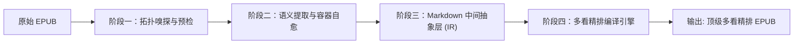

# 通用电子书重构与多看精排制作规范体系 (Universal EPUB Pipeline Spec)

本文档系统性沉淀从原始 EPUB（Calibre/Sigil 等格式）自动化转化为高质量「多看精排 EPUB」的核心技术规范与处理法则。

---

## 一、通用架构与四阶流水线 (Four-Stage Pipeline)

### 阶段一：拓扑嗅探与预检 (Topology Audit & Sniffing)
1. **多卷合集自适应探测**：
   * 解析 `toc.ncx` / `nav.xhtml` 的树形深度：若顶级 `navPoint` 下包含子节点且数量 $\ge 2$，判定为 `多卷合集 (Multi-Volume)`；否则为 `单本标准书籍`。
   * **多卷拓扑处理法则**：各分卷首节点（全屏彩插或扉页大图）就地保留，绝不可将其挪到全书最前方篡改封面。
2. **主题色嗅探机制 (Theme Color Sniffer)**：
   * 自动遍历原书 CSS，提取其章节标题（`h1`、`h2`、`.calibre3` 等）使用的专有主色调（如 `#bf4047`、`#8e6c46`）；
   * 将该颜色动态赋给多看精排章节标题、章号、实线下划线及引文装饰边框，实现视觉灵魂的精准继承。
3. **全书超链接互跳审计**：
   * 扫描注释互跳（Footnotes）、正文/图表交叉引用（Cross References）与原生表格（Tables），建立锚点字典。

---

### 阶段二：语义提取与容器自愈 (Semantic Extraction & Container Guard)
1. **容器防重复消费原则（First-Principles Container Guard）**：
   * 当扫描到复合容器（`<blockquote>`、`<table>`、`figure`/`div.chatu`）时，完整处理内部所有结构；
   * 正文遍历器在扫描到 `
`、``、`` 时，若其父级属于已消费的复合容器，**一律跳过**，从机制上杜绝文字重复输出。
2. **通用扉页智能提取器 (Smart Title-Page Extractor)**：
   * 启发式扫描前置页面中含有 `shuming`、`feiye`、`titlepage`、`book-title` 类的结构；
   * 提取书名、副标题、著者、译者、出版机构，生成标准的 `.feiye-wrap` 语义块；
   * 自动在中间稿 YAML 元数据中注入 `title_page: false`，彻底消除构建器默认生成的死板占位扉页。
3. **全兼容双向弹注引擎 (Universal Footnote Engine)**：
   * **定义点特征**：ID 以 `n`、`def`、`back` 结尾，或父级带有 `.footnote`/`.calibre18`/`.notes` 类；
   * **引用点特征**：位于段落行内或包含于 ``，其 `href` 指向定义点；
   * 严禁将正文段落中的引用锚点误判为定义，防止正文段落被误删；
   * 转换为多看标准弹注 `[^vol_num]`，支持轻触小图标无感浮层弹窗。
4. **行内断行与落款特征继承 (Signatures & Line Breaks)**：
   * 段落提取时将内部 ` ` 显式转换为分行；
   * 段落类名包含 `kaiti5`、`right` 或以 `——` 开头时，保留 `
` 语义，呈现右对齐、楷体、行间紧凑的书籍落款。
5. **图文智能贴合绑定 (Image & Caption Binding)**：
   * 识别 `.chatu`、`.alone`、`p.tushuo`，将图说与对应插图绑定为 ``；
   * 编译时生成 `.duokan-image-single` + `.duokan-image-maintitle`，居中贴合在图片正下方。

---

### 阶段三：Markdown 中间抽象层 (Neutral IR)
以标准化纯文本存储中间状态，具备极佳的人工可读性与可维护性：
* 分卷：`# 第一卷 书名`
* 全屏图：`## 彩插 [fullscreen]`
* 楷体页：`## 代序 [kaiti]`
* 文字扉页：`## 扉页 [feiye]` + 规范 `.feiye-wrap`
* 诗文引言：`> 第一句`、`> 第二句`、`> 
——落款
`

---

### 阶段四：多看精排编译引擎 (Compiler)
1. **原生 HTML 块直通 (Passthrough)**：
   * 遇到已知 HTML 结构标签（`
`、`
`）直接透传输出，绝不执行实体转义；
   * 遇到 `
...
` 时，透传外层标签的同时执行行内元素（Markdown/弹注）编译。
2. **章节属性自适应注入**：
   * 识别 `[kaiti]` 标签或“代序/代译序/序章”标题，自动注入 `<body class="kaiti-body">`；
   * 识别 `[fullscreen]` 标签，自动在 spine 中注入 `duokan-page-fullscreen`；
   * 识别 `[feiye]` 扉页标签，跳过标准章节大标题生成，直接渲染典雅居中版式。
3. **样式分层继承 (CSS Cascade)**：
   * **全局底座**：多看核心版式标准（字号阶梯、段落缩进、夜间模式适配）；
   * **动态覆盖**：由书籍同级 `style.css` 注入嗅探到的主题色与特色下划线，实现原版视觉的无损复刻。
